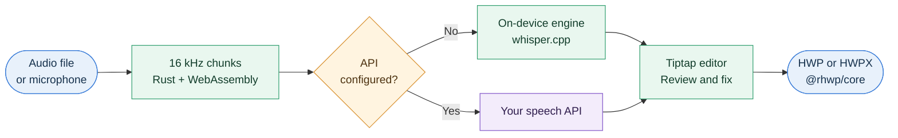

<div align="center">

<picture>
  <source media="(prefers-color-scheme: dark)" srcset="assets/images/logo-dark.png" />
  <source media="(prefers-color-scheme: light)" srcset="assets/images/logo-light.png" />
  
</picture>

<h3>Say it once. Have it in writing, in any language.</h3>

<p>
Transcribe audio, translate live conversations, review the text, and export HWP or HWPX.<br/>
Run recognition on your own device, or bring your own API.
</p>

<p>


<a href="LICENSE"></a>
</p>

<p>
<a href="#quick-start">Quick Start</a> ·
<a href="#how-it-works">How It Works</a> ·
<a href="docs/ENGINE.md">Engine</a> ·
<a href="docs/DEPLOYMENT.md">Deployment</a>
</p>

</div>

<br/>

<div align="center">
<picture>
  <source media="(prefers-color-scheme: dark)" srcset="assets/videos/hero-dark.webp" />
  <source media="(prefers-color-scheme: light)" srcset="assets/videos/hero-light.webp" />
  
</picture>
</div>

## What is 말새김?

말새김 means "engraving speech." Say it **mahl-seh-geem** (IPA: /mal.sɛ.ɡim/, romanized: *malsaegim*).

It's a self-hosted web app that turns speech into native Hangul documents. Drop in a recording or start talking, fix the transcript in a real editor, and export an HWP or HWPX file. It needs no database and keeps your notes in your browser.

Most speech-to-text tools stop at a text file. In Korea, work often isn't finished until it's in a Hangul document.

## Features

- **File transcription:** Import audio and get timestamped paragraphs. Failed chunks are marked in the editor, and you can retry just those.
- **Live dictation:** Text appears as you speak. Recordings save continuously, so they survive a closed tab.
- **Realtime translation:** Hear and read a live translation, with the original and translated text saved as paired paragraphs.
- **On-device recognition:** Run Korean speech recognition in the browser with whisper.cpp and Whisper large-v3-turbo, without an API key. Live captions and file transcription share one model.
- **Bring your own API:** Connect any OpenAI-compatible transcription endpoint.
- **Speaker labels:** After dictation, voices are grouped in the browser and each paragraph is labeled by speaker. Click a label to set a name.
- **HWP and HWPX export:** Set the paper size, margins, and fonts for each note, then download a native document.
- **Made for daily use:** Autosave, audio playback, light and dark themes, and a responsive mobile layout are built in.

## Live Dictation

Press record and watch your words appear as you speak. Recordings save continuously, so they survive a closed tab. When you stop, the transcript becomes a timestamped note you can edit and export.

<div align="center">
<picture>
  <source media="(prefers-color-scheme: dark)" srcset="assets/videos/dictation-dark.webp" />
  <source media="(prefers-color-scheme: light)" srcset="assets/videos/dictation-light.webp" />
  
</picture>
</div>

## Realtime Translation

Follow a conversation across languages as it happens. The original and the translation appear side by side, and you can listen to the translated voice. When you're done, both are saved as paired paragraphs in a note.

<div align="center">
<picture>
  <source media="(prefers-color-scheme: dark)" srcset="assets/videos/translation-dark.webp" />
  <source media="(prefers-color-scheme: light)" srcset="assets/videos/translation-light.webp" />
  
</picture>
</div>

## Recognition Modes

말새김 picks the mode from your settings. If all three API fields are set, it uses your API. Otherwise, it runs on your device.

| | On-Device | Bring Your Own API | Realtime Translation |
|---|---|---|---|
| **Best for** | Private Korean transcription | Long files and more languages | Live conversations |
| **Engine** | whisper.cpp (Whisper large-v3-turbo / small) | Your choice | OpenAI `gpt-realtime-translate` |
| **API key** | Not required | Required | Required |
| **Where audio goes** | Stays in your browser | Through the app server to your API | Directly to OpenAI over WebRTC |
| **Languages** | Korean | Depends on your API | 58 target languages |

> [!NOTE]
> The server never stores audio or documents. In the two API modes, your audio is sent to the provider you configured, under that provider's terms.

## Quick Start

You'll need Docker. The first build takes a while because it downloads the models (about 1.1 GB) and compiles the engines.

```sh
git clone https://github.com/scorpion1201/malsaegim.git
cd malsaegim
cp .env.example .env
docker compose up -d --build
```

Open <http://localhost:8888>. Microphone features need `localhost` or HTTPS.

To skip the on-device models or deploy behind a reverse proxy, see the [Deployment Guide](docs/DEPLOYMENT.md).

## How It Works



The browser handles audio processing, recognition, and editing. The Next.js server only relays API requests and generates documents, so it stays stateless. Notes live in `localStorage`, audio in IndexedDB, and models in Cache Storage.

## Tech Stack

| Layer | Technology |
|---|---|
| Web app | Next.js 16, React 19, TypeScript, CSS Modules |
| Editor | Tiptap 3 |
| Audio | Rust, WebAssembly, Web Workers, AudioWorklet |
| On-device speech | whisper.cpp, Emscripten, WebGPU |
| Realtime | WebRTC, OpenAI Realtime API |
| Documents | `@rhwp/core` |
| Deployment | Docker, Docker Compose |

## Development

You'll need Node 20+, Yarn 4, Rust stable, the `wasm32-unknown-unknown` target, and wasm-pack.

```sh
yarn install
yarn dev        # Builds the audio wasm, then starts Next.js
yarn lint       # Runs type checks and ESLint
yarn build      # Creates a production build
yarn models     # Optional: builds the on-device models with Docker
```

Without `public/models`, the app still runs, but only with an API configured.

## Browser Support

- **On-device recognition** needs WebAssembly SIMD and cross-origin isolation. It uses WebGPU when the browser supports it, and the CPU otherwise.
- **Model per device:** PCs and iPads get Whisper large-v3-turbo. Phones get Whisper small unless they report 8 GB or more of memory. You can switch in Settings.
- **Speed:** On CPU, Turbo is several times slower than real time on a 4-core machine, so live captions lag. Mobile and WebGPU performance hasn't been verified yet.
- **Realtime translation** is tuned for Chrome, which provides echo cancellation for shared speakers.

## Known Limitations

Realtime translation is new, and these areas still need work:

- Quiet speech in the source language may not be recognized.
- Long sessions, network recovery, and billing haven't been tested end to end.
- The on-device model recognizes Korean only.

## Documentation

- [Architecture](docs/ARCHITECTURE.md): system design, data stores, and security
- [Deployment](docs/DEPLOYMENT.md): Docker, configuration, reverse proxy, and troubleshooting
- [Engine](docs/ENGINE.md): building and changing the on-device engine

## Acknowledgments

말새김 stands on the work of these projects:

- [whisper.cpp](https://github.com/ggml-org/whisper.cpp) for on-device recognition
- [OpenAI Whisper](https://github.com/openai/whisper) large-v3-turbo and small, in the [whisper.cpp ggml distribution](https://huggingface.co/ggerganov/whisper.cpp)
- [3D-Speaker](https://github.com/modelscope/3D-Speaker) CAM++ in the [sherpa-onnx distribution](https://github.com/k2-fsa/sherpa-onnx) and [ONNX Runtime Web](https://github.com/microsoft/onnxruntime) for speaker labels
- [`@rhwp/core`](https://www.npmjs.com/package/@rhwp/core) for HWP and HWPX generation
- [Tiptap](https://tiptap.dev) for the editor

## License

말새김 is available under the [MIT License](LICENSE).

<br/>

<p align="center">Made with ❤️ and open source.</p>