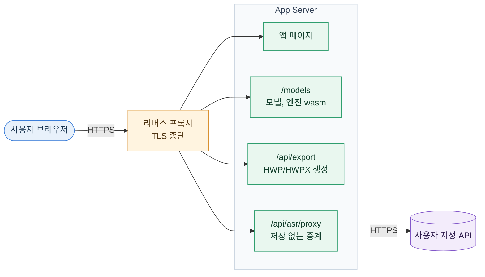

# Deployment Guide

This guide covers deploying and operating 말새김 on a server you manage. Docker Compose is the default path. On a server with only Node installed, you can run the standalone build instead.



서버에는 데이터 저장소가 없어 볼륨이 필요 없다. 음성 인식 API 설정은 각 사용자의 브라우저에 있다.

## 1. Quick Start

```sh
cp .env.example .env
docker compose up -d --build
curl -f http://localhost:8888/healthz
```

Compose 는 호스트 포트 8888 을 컨테이너 3000 으로 연결한다. 모델을 포함한 첫 빌드는 25~40분 걸린다. 모델이 필요 없으면 [4.3](#43-build-without-models) 을 참고한다.

## 2. Configuration

`.env` 에 넣는 서버 변수는 모두 선택이다.

| 변수 | 용도 | 비어 있을 때 |
|---|---|---|
| `APP_SHARED_PASSWORD` | 공유 비밀번호 로그인 | 로그인 페이지 없이 바로 열린다. |
| `AUTH_COOKIE_SECRET` | 세션 쿠키 서명. `openssl rand -hex 32` 로 만든다. | 비밀번호에서 파생한 키를 쓴다. 비밀번호를 바꾸면 기존 로그인이 풀린다. |
| `RHWP_WASM_PATH` | rhwp wasm 경로 지정 | `node_modules/@rhwp/core/rhwp_bg.wasm` 을 쓴다. |
| `NEXT_PUBLIC_SITE_URL` | 공유 링크(Open Graph) 기준 주소. 빌드 때 고정된다. | `http://localhost:3000` 을 쓴다. |
| `ASR_PROXY_ALLOWED_HOSTS` | API 프록시 대상 호스트(쉼표 구분, `.example.com` 은 하위 도메인) | 공개 주소 전체를 허용한다. |

음성 인식 API 의 키, 주소, 모델은 서버 변수가 아니다. 각 사용자가 설정 페이지에 저장하고, `/api/asr/proxy` 는 저장 없이 전달만 한다.

## 3. Deployment Methods

### 3.1. Docker Compose

서비스 이름은 `malsaegim` 이다. 값은 `environment` 에 열거돼 있고 셸 환경이나 프로젝트 `.env` 에서 Compose 변수 치환으로 채워진다. 헬스체크는 인증을 거치지 않는 `/healthz` 를 쓴다.

```sh
docker compose up -d --build
docker compose logs -f malsaegim
docker compose down
```

### 3.2. Deployment Script

`scripts/deploy.sh` 는 값을 확인해 안내하고 원격 Docker 대상으로도 배포한다.

```sh
sh scripts/deploy.sh -d --build
sh scripts/deploy.sh --context prod -d --build   # 원격 Docker 컨텍스트로 배포
```

- 값은 셸 환경, `.env` 순으로 읽는다. `APP_SHARED_PASSWORD` 가 없으면 로그인 비활성 안내만 하고 그대로 띄운다.
- 앞쪽의 `--context/-c`, `--host/-H`, `--config`(`--context=NAME` 형태 포함)는 `DOCKER_CONTEXT`, `DOCKER_HOST`, `DOCKER_CONFIG` 로 Docker CLI 에 전달된다. 환경 변수를 직접 지정해도 된다.
- 그 뒤 인자는 전부 `docker compose up` 으로 넘어간다.
- Finder 등에서 단독 창으로 실행하면 compose 가 끝난 뒤 셸을 이어서 띄워 창이 닫히지 않게 한다.

### 3.3. Docker Run

```sh
docker build -t malsaegim .
docker run --rm -p 3000:3000 --env-file .env malsaegim
```

### 3.4. Standalone Node

빌드 머신에는 Node 20+, Yarn 4(`corepack enable`), Rust stable, `wasm32-unknown-unknown`, wasm-pack 0.15 가 필요하다. 런타임 서버에는 Node 만 있으면 된다.

```sh
rustup target add wasm32-unknown-unknown
cargo install wasm-pack
yarn install
yarn build             # build:wasm → next build (output: standalone)
cp -R public .next/standalone/public 2>/dev/null || true
cp -R .next/static .next/standalone/.next/static
cd .next/standalone && PORT=3000 node server.js
```

macOS 에서 Homebrew rust 가 함께 있으면 `export PATH="/opt/homebrew/opt/rustup/bin:$PATH"` 를 먼저 실행한다.

`@rhwp/core` 의 wasm 은 `outputFileTracingIncludes` 로 standalone 에 포함된다. `.next/standalone/node_modules/@rhwp/core/rhwp_bg.wasm` 이 있는지 확인한다.

### 3.5. Build Locally, Then Transfer

```sh
# 1. 로컬에서 빌드한다. NEXT_PUBLIC_SITE_URL 은 .env 에서 읽어 빌드에 고정된다.
docker compose build malsaegim

# 2. 이미지 아키텍처가 서버(uname -m)와 같은지 확인한다.
docker image inspect malsaegim:latest --format '{{.Architecture}}'

# 3. 서버로 옮긴다.
docker save malsaegim:latest | gzip | ssh prod 'gunzip | docker load'

# 4. 서버의 컨테이너를 새 이미지로 교체하고, 태그를 잃은 이전 이미지를 지운다.
docker --context prod compose up -d --no-build --pull never malsaegim
docker --context prod image prune -f
```

- 다른 Compose 파일을 쓰는 서버는 1번과 4번의 `compose` 뒤에 `-f <파일>` 을 붙인다.
- 서버 아키텍처가 로컬과 다르면 1번을 `DOCKER_DEFAULT_PLATFORM=linux/amd64 docker compose build malsaegim` 처럼 실행한다. 에뮬레이션이라 훨씬 느리다.
- 4번의 환경 변수는 로컬의 셸과 `.env` 에서 읽는다. 값을 바꿀 때 서버의 파일을 고칠 필요가 없다.

## 4. Building the Image

### 4.1. Build Stages

| 스테이지 | 역할 |
|---|---|
| `wasm` | 오디오 분할 wasm 빌드 |
| `fetch` | whisper 모델 내려받기(리비전·sha256 고정) |
| `emsdk` | 엔진 wasm 빌드(CPU·WebGPU 런타임) |
| `manifest` | 모델 `manifest.json` 생성 |
| `models` | 모델 산출물만 꺼내기 (`yarn models`) |
| `build` | `next build`(standalone) |
| `server` | Node 와 앱만 담은 런타임 이미지 |

엔진 빌드의 세부 사항은 [ENGINE.md](ENGINE.md) 에 있다.

### 4.2. Network Access

빌드 중에는 crates.io, npm, Google Fonts, wasm-pack 이 받는 wasm-bindgen/binaryen, 모델을 받는 huggingface.co, emscripten `emdawnwebgpu` 포트를 받는 GitHub 릴리스에 접근할 수 있어야 한다. Google Fonts 는 `next/font` 가 IBM Plex Sans KR 을 내려받아 자체 호스팅할 때 쓴다.

### 4.3. Build Without Models

```sh
docker build --build-arg WITH_MODELS=0 -t malsaegim .
```

모델을 넣으면 이미지가 ≈ 1.1 GB 커진다(Turbo q8_0 ≈ 834 MiB, small q8_0 ≈ 252 MiB, 엔진 wasm 두 벌 ≈ 6 MB, 화자 구분 런타임·모델 ≈ 41 MiB). 서버에는 두 모델이 다 있지만 브라우저는 기기에 맞는 하나만 받는다. `WITH_MODELS=0` 이면 화자 구분도 꺼진다.

### 4.4. Image Contents

`.dockerignore` 가 `.env*`(예시 제외), `docs/`, `AGENTS.md`, `node_modules`, `target/` 등을 뺀다. 비밀값은 이미지에 들어가지 않으므로 실행 시 넘긴다. 아래 명령 결과에 `.env` 와 `docs` 가 없어야 한다.

```sh
docker run --rm malsaegim sh -c 'ls -a /app; ls /app/docs 2>&1'
```

## 5. Reverse Proxy

| 항목 | 설정 | 이유 |
|---|---|---|
| HTTPS | 프록시에서 종단 | 프로덕션 쿠키가 `Secure` 이고 마이크는 HTTPS 가 필요하다. |
| 본문 크기 | `client_max_body_size 16m;` | 조각은 최대 12MB 다(240초 WAV ≈ 7.7MB). |
| 읽기 타임아웃 | `proxy_read_timeout 180s;` | `/api/asr/proxy` 는 최대 2분 걸릴 수 있다. |
| 격리 헤더 | `Cross-Origin-Opener-Policy: same-origin`, `Cross-Origin-Embedder-Policy: require-corp` 유지 | 벗기면 On-Device 인식이 멈춘다. |
| 모델 캐시 | `/models/<묶음>/<hash>/*` 는 프록시 캐시 가능 | `Cache-Control: immutable` 이고 Turbo 파일 하나가 ≈ 834 MiB 다. 프록시 본문 크기 제한을 확인한다. |

## 6. On-Device Models

API 설정이 없는 브라우저는 서버가 `public/models/` 로 서빙하는 모델과 wasm 을 Cache Storage 에 한 번 내려받아 브라우저 안에서 인식한다.

- **구조:** `manifest.json` + `runtime/<hash>/`(엔진 js·wasm) + `<model-id>/<sha256 12자리>/`(모델). `public/models` 는 git 에 없다.
- **모델:** whisper large-v3-turbo Q8_0(기본)과 small Q8_0(메모리가 적은 모바일 기본). 실시간·파일 전사가 같은 파일을 쓴다. 자세한 내용은 [ENGINE.md](ENGINE.md) 에 있다.
- **이미지 빌드:** `docker build` 가 항상 이미지 안에서 만든다. 모델 내려받기(≈ 1.1 GB)와 엔진 두 벌 빌드가 대부분이고, 이후에는 BuildKit 캐시로 스크립트가 바뀌지 않는 한 재사용한다.
- **로컬 개발:** `yarn models` 가 Docker 의 `models` 스테이지를 `public/models` 로 꺼낸다. 툴체인을 갖춘 머신은 `yarn models:native` 를 쓴다.
- **버전 교체:** 엔진이나 모델이 바뀌면 브라우저는 바뀐 파일만 다시 받고 이전 캐시를 지운다.
- **브라우저 조건:** WebAssembly SIMD 와 교차 출처 격리가 필요하다. WebGPU(shader-f16)가 있으면 GPU 로 돌리고, 없으면 CPU 로 돌린다.
- **메모리:** Turbo 는 CPU 실행 시 wasm 힙 ≈ 1.67 GB, small 은 ≈ 1.0 GB 다. 메모리가 부족해 로드에 실패하면 설정에서 small 로 바꾸라고 안내한다. 음성을 API 로 자동 전송하지 않는다.
- **시크릿 창:** Chromium 시크릿 창은 Cache Storage 를 메모리에 두어 Turbo(874 MB)를 저장하지 못한다.

## 7. Operations

- **동시 호출:** 브라우저마다 8개(`BYOK_CONCURRENCY`), On-Device 는 1개다. `/api/asr/proxy` 는 프로세스당 동시 24건까지 받고 넘으면 429 를 돌려준다. 최대 약 480MB 를 쓰므로 컨테이너 메모리에 맞춰 `MAX_ACTIVE_REQUESTS` 를 조정한다.
- **접근 제어:** 인터넷에 공개하는 서버는 `APP_SHARED_PASSWORD` 를 설정한다. 비워 두면 프록시도 누구나 호출할 수 있다.
- **HTTPS:** 사용자 키 암호화에 쓰는 Web Crypto 는 HTTPS 와 `localhost` 에서만 동작한다. 평문 http 로 열면 키가 평문으로 저장된다.
- **외부 연결:** 앱 검증과 별도로 방화벽에서 컨테이너의 내부망, 클라우드 메타데이터 주소(`169.254.169.254`) 접근을 막는다.
- **API 429:** 클라이언트가 지수 백오프로 재시도한다.
- **녹음 원본:** WAV 는 서버에 올라가지 않고 각 브라우저의 IndexedDB 에만 남는다.

### 7.1. Disk Cleanup

```sh
docker system df          # 사용량 확인
docker builder prune -af  # 빌드 캐시 전체 삭제
docker image prune -f     # 컨테이너가 쓰지 않는 태그 없는 이미지 삭제
```

- 빌드 캐시는 프로젝트별로 나뉘지 않는다. 같은 서버의 다른 프로젝트도 다음 빌드가 처음부터 돈다.
- 같은 서버에 다른 서비스가 있으면 `docker system prune -a --volumes` 는 쓰지 않는다. 멈춘 서비스의 이미지와 사용 중이 아닌 볼륨까지 지운다.

## 8. Troubleshooting

| 증상 | 원인 | 조치 |
|---|---|---|
| 녹음 버튼이 "마이크를 쓸 수 없습니다" 오류를 낸다. | 브라우저는 HTTPS 또는 `localhost` 에서만 `getUserMedia` 를 허용한다. | 프록시에서 TLS 를 끝내거나 각 PC 에서 `localhost` 로 접속한다. |
| 설정 카드에 "서버에 모델이 없습니다" 가 뜬다. | `public/models` 가 비어 있다. 앱은 BYOK 만 된다. | `yarn models` 를 실행하거나 모델을 포함해 이미지를 빌드한다. |
| On-Device 인식을 쓸 수 없다. | 프록시가 COOP/COEP 헤더를 벗겼다. 설정 카드에 이유가 표시된다. | 프록시에서 격리 헤더를 유지한다. |
| HWP 내보내기가 실패한다. | standalone 에 rhwp wasm 이 빠졌을 수 있다. | [3.4](#34-standalone-node) 의 경로에 파일이 있는지 확인한다. |