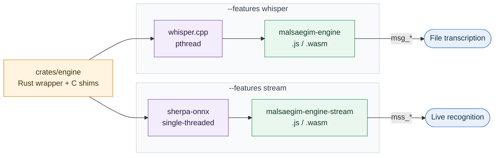

# On-Device Engine Guide

In-browser speech recognition runs on `malsaegim-engine`, a thin Rust wrapper around C++ engines. Rust owns the public API and the text cleanup, and C++ does the heavy lifting. Read this guide before you change or rebuild the engine.

## 1. Engine Overview

A single crate builds twice, once per feature, and produces two wasm binaries. JavaScript only ever talks to `malsaegim-engine`.



| | File transcription | Live recognition |
|---|---|---|
| Feature | `whisper` | `stream` |
| C++ engine | whisper.cpp | sherpa-onnx |
| Output | `malsaegim-engine.{js,wasm}` | `malsaegim-engine-stream.{js,wasm}` |
| Exports | `msg_*` | `mss_*` |
| Threading | pthread | Single-threaded |
| Rust toolchain | Nightly with build-std | Stable |

We can't merge these into one wasm binary because their threading models differ: onnxruntime has no threaded build.

## 2. Source Layout

```text
crates/engine/
├── src/
│   ├── lib.rs        # Entry point; selects modules by feature
│   ├── core/         # Low-level C++ FFI, not a Rust reimplementation
│   ├── pipeline/     # Transcription pipelines (msg_* file, mss_* live)
│   ├── utils/        # clean (hallucination filter), detokenize (BPE ▁ to space)
│   └── bin/xtask.rs  # Build tool; drives cargo and emcc without bash
├── csrc/             # Thin C shims: whisper_shim.cpp, sherpa_shim.cpp
└── build.rs          # Builds the C++ libraries and shims per feature, records link inputs
```

Native builds export no symbols, so a plain `cargo build` always passes. Don't rely on it to verify engine behavior.

## 3. Building

### 3.1. Requirements

- **emsdk:** 4.0.23
- **Rust:** nightly, `wasm32-unknown-emscripten`, `rust-src`
- **Other:** cmake

### 3.2. Build Commands

```sh
cargo run -p malsaegim-engine --bin xtask --release -- <out-dir> [work-dir]
```

This writes both wasm binaries to `<out-dir>`. Set `WHISPER_CPP_DIR` and `SHERPA_ONNX_DIR` to use existing checkouts. Otherwise xtask clones the pinned revisions.

To build the models as well, run one of these from the repo root:

```sh
yarn models          # Builds in Docker and exports to public/models
yarn models:native   # Builds with your local toolchain
```

### 3.3. Updating Engine Versions

Engine revisions are pinned in two places, and they must match:

- `WHISPER_CPP_REF` and `SHERPA_ONNX_REF` in `crates/engine/src/bin/xtask.rs`
- The variables of the same name in `scripts/models/versions.sh`

Changing either revision changes the artifact hash, so browsers download the files again.

## 4. Design Constraints

### 4.1. Link with emcc

If you build the crate as a `bin` or `cdylib` and let **rustc drive the Emscripten link**, the link succeeds but **whisper.cpp hangs in the encoder** with progress stuck at 0. The link flags rustc passes are incompatible with ggml.

Instead, the crate builds as a `staticlib`, and **emcc does the final link through xtask**. This is the same approach as an embind C++ build.

### 4.2. Rebuild std for pthread

The pthread build needs a standard library compiled with atomics, so the whisper build recompiles std with:

```text
nightly + -Z build-std + -C target-feature=+atomics,+bulk-memory,+mutable-globals
```

### 4.3. Use q8_0 Quantization

q6_k fails to load in both wasm and native builds. The whisper.cpp loader miscalculates the size of `decoder.token_embedding.weight` because `ggml_nbytes` overflows. q8_0 is the most precise quantization that loads.

## 5. Gotchas

- **Artifact file names:** Serve them unchanged. emcc references these names internally, and pthread workers load the same file again.
- **sherpa stack size:** Keep `-sSTACK_SIZE=10MB`. With the default 64 KB, the first inference goes out of bounds.
- **whisper context:** Keep `flash_attn=false`.