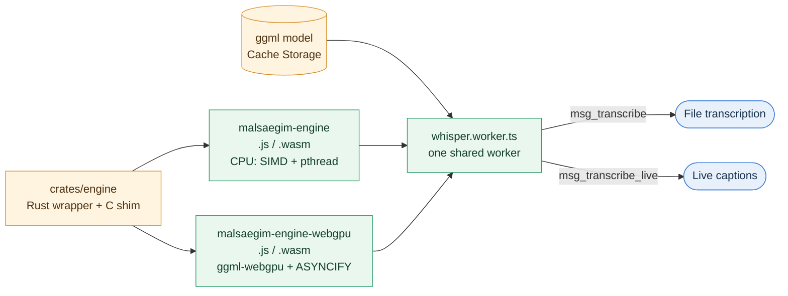

# On-Device Engine Guide

In-browser speech recognition runs on `malsaegim-engine`, a thin Rust wrapper around whisper.cpp. Rust owns the public API and the text cleanup, and C++ does the heavy lifting. File transcription and live captions both use this one engine and the same model file. Read this guide before you change or rebuild the engine.

## 1. Engine Overview

One crate builds two runtimes. Both load the same ggml model, and the app picks one at load time.



| | CPU runtime | WebGPU runtime |
|---|---|---|
| Output | `malsaegim-engine.{js,wasm}` | `malsaegim-engine-webgpu.{js,wasm}` |
| Backend | ggml-cpu, wasm SIMD128, pthread pool | ggml-webgpu (emdawnwebgpu port), CPU for unsupported ops |
| Calls | Synchronous `ccall` | `ccall(..., { async: true })` (ASYNCIFY) |
| Requirement | WebAssembly SIMD, cross-origin isolation | Also WebGPU with the `shader-f16` feature |
| Exports | `msg_init`, `msg_gpu_name`, `msg_transcribe`, `msg_transcribe_live`, `msg_free`, `msg_free_cstr` | Same |

We keep two runtimes because ASYNCIFY instruments the whole module and slows the CPU path. The app tries WebGPU first. If the adapter is missing, lacks `shader-f16`, or the GPU load fails, the host terminates that worker and starts the CPU runtime. It doesn't retry WebGPU in that tab after that. Users can turn WebGPU off in settings.

## 2. Models

| Model | File | Bytes | wasm heap after load | Default for |
|---|---|---|---|---|
| Whisper large-v3-turbo Q8_0 | `ggml-large-v3-turbo-q8_0.bin` | 874,188,075 | 1,667 MB (CPU) | PC, iPad, phones reporting `deviceMemory >= 8` |
| Whisper small Q8_0 | `ggml-small-q8_0.bin` | 264,464,607 | 1,016 MB (CPU) | Other phones, including every iPhone |

- **Source:** `ggerganov/whisper.cpp` on Hugging Face, the official ggml distribution. `scripts/models/versions.sh` pins the revision and sha256, and `fetch-whisper-models.sh` verifies both after download.
- **Language:** The app always passes `ko`. Auto-detection drifts to other languages on short windows.
- **Heap vs file:** The file size isn't the memory cost. Turbo's weights take 874 MB, and the KV cache plus compute buffers add about 400 MB (encode buffer 212 MB). The heap reaches 1,667 MB under the 2 GB `MAXIMUM_MEMORY`, so the limit stays at 2 GB. With WebGPU, the weights live in GPU buffers.
- **Device choice:** `deviceProfile.ts` combines the Apple platform, touch points, iOS-only APIs, screen size, pointer media queries, and `navigator.deviceMemory`. A user agent alone can't separate iPadOS from macOS. Browsers don't expose RAM size, and iOS doesn't expose `deviceMemory`, so iPads get Turbo and iPhones get small. Users can override the choice in settings.
- **iOS and iPadOS:** Every browser there is WebKit, and a Safari tab is killed at about 2 GB (iOS 27.2 logs show `Memory Limits: active 2048`), whatever the device RAM. GPU buffers count against the same limit. In WebKit 27.2 on a Mac, Turbo on CPU peaks at 1,687 MB for the page process. On WebGPU it reaches 2,058 MB right after loading and then aborts with a queue timeout, so the app never uses WebGPU on iOS. Turbo on CPU is slow there: 30 s of audio took 90 s with 8 threads and 154 s with 4 threads on an M1 Max, and an iPad Pro M1 (4 performance cores) is slower than that.

### 2.1. Download and Cache

```text
public/models/
├── manifest.json                                   # schema 2: runtime + models
├── runtime/<hash of the four runtime files>/        # js+wasm must share a directory
└── <model-id>/<first 12 hex of the file sha256>/<file>
```

- Each browser downloads the runtime plus **one** model into Cache Storage (`malsaegim-models`). Live captions and file transcription read the same cached file, so nothing is downloaded twice.
- Downloads stream through a SHA-256 hasher (`sha256.ts`) straight into `cache.put`. Nothing buffers the whole file, and a size or hash mismatch deletes the entry.
- Content-hashed URLs mean a runtime update doesn't re-download the model, and a model update doesn't re-download the runtime. On startup, files that aren't in the manifest are deleted. After a model switch finishes downloading, the previous model is deleted.
- Chromium incognito windows keep Cache Storage in memory and reject an 874 MB `put`. The error says so.

### 2.2. Loading

The worker mounts the cached `Blob` with WORKERFS. whisper.cpp reads through a 16 MB stdio buffer, so the model is never copied into the JS heap. The default `ifstream` loader made about 130,000 `FileReaderSync` calls and took 87 s for small; the buffered loader makes about 2,000 calls.

## 3. Live Captions

`liveSession.ts` holds the state machine. `whisperLive.ts` connects it to the shared worker.

- **Buffer:** Holds the audio from the last committed point to now, using the recording timeline (the same samples as the saved WAV). The shared `voiceDetector` marks each 100 ms frame by voice periodicity and an adaptive noise floor, so it works at any input level. Silence is never recognized.
- **Updates:** With at least 1 s of new audio, the whole window is recognized again. Only one request is ever in flight.
- **Commit:** Words that two consecutive results agree on, from the start (LocalAgreement-2), are committed. Committed words never change. Words within 300 ms of the window end wait for the next pass. The buffer is trimmed only when a sentence is emitted, so a sentence is always recognized with its full context. The already committed part of each new result is removed by character-level alignment (spaces ignored), because Whisper re-spaces words between passes and even joins words across the commit boundary.
- **End of utterance:** After 700 ms of silence, the window up to the last speech plus 100 ms is recognized once more and fully committed. The VAD holds quiet word endings through hysteresis and a 200 ms hangover. Windows with under 300 ms of speech are dropped, because tiny fragments make Whisper hallucinate. On stop, everything up to the last sample is flushed.
- **Long speech and slow devices:** Over 20 s, the window is cut at the latest silence after 8 s (or a word boundary) and the front part is flushed. On a device slower than real time, the backlog is processed in 20 s pieces. Captions arrive late, and the UI shows "처리 지연", but nothing is lost. Over 10 minutes of backlog, the oldest audio is skipped and marked in the note.
- **Finals:** Committed words are emitted as sentences at `. ? !`, or after 15 s. Words repeated across a cut are removed.
- **Stop, restart, cancel:** `finish` flushes the remaining speech before it resolves. `terminate` discards in-flight results, so a new session never sees them. If the worker crashes, it restarts once and the buffered audio continues.
- **Encoder length:** On CPU, partial passes shrink the encoder to the window length (`audio_ctx`). Every pass that commits text to the note (flush) uses the full 30 s encoder, because a shortened encoder caused tail hallucinations ("MBC") and repetition loops in wasm. On WebGPU, every pass uses the full encoder.

## 4. Building

### 4.1. Requirements

- **emsdk:** 4.0.23. The WebGPU runtime uses the bundled `emdawnwebgpu` port, which downloads from GitHub on first use.
- **Rust:** nightly, `wasm32-unknown-emscripten`, `rust-src`
- **Other:** cmake, python3 (ggml-webgpu embeds its WGSL shaders at build time)

### 4.2. Build Commands

```sh
cargo run -p malsaegim-engine --bin xtask --release -- <out-dir> [work-dir]
```

This writes both runtimes to `<out-dir>`. Set `WHISPER_CPP_DIR` to use an existing checkout. Otherwise xtask clones the pinned revision.

To build everything from the repo root:

```sh
yarn models          # Builds in Docker and exports to public/models
yarn models:native   # Builds with your local toolchain
```

### 4.3. Updating Versions

- **whisper.cpp:** `WHISPER_CPP_REF` in `crates/engine/src/bin/xtask.rs` and in `scripts/models/versions.sh` must match.
- **Models:** `WHISPER_MODEL_REVISION` and the `*_SHA256` values in `versions.sh`. Then update `MODELS` in `write-manifest.mjs`, including `memoryMB`, which is a measured value.

Changing any file changes its content-hashed URL, and browsers download only that file again.

## 5. Accuracy Evaluation

`scripts/eval/` measures CER with native whisper.cpp, using the same ggml model and decoding settings as the app. Native results measure accuracy only. Don't treat them as wasm speed.

```sh
python3 -I scripts/eval/prepare.py zeroth /tmp/eval/zeroth --n 40   # read speech, CC BY 4.0
python3 -I scripts/eval/prepare.py kspon  /tmp/eval/kspon  --n 40   # spontaneous speech
python3 -I scripts/eval/prepare.py jeju   /tmp/eval/jeju   --n 40   # Jeju dialect
python3 -I scripts/eval/cer.py --cli <whisper-cli> --model turbo=<bin> --model small=<bin> \
  --set zeroth=/tmp/eval/zeroth --set kspon=/tmp/eval/kspon --set jeju=/tmp/eval/jeju --out /tmp/eval/report.json
```

KsponSpeech and the Jeju dialect set are AI Hub data mirrored by third parties. Their terms forbid redistribution, so evaluate them locally only. Never commit audio or transcripts.

### 5.1. Results (2026-11-01)

Native whisper.cpp v1.9.5, greedy decoding, no temperature fallback, no context carry-over, 40 utterances per set:

| Set | Turbo Q8_0 | small Q8_0 |
|---|---|---|
| Zeroth (read speech) | **5.33%** | 11.57% |
| KsponSpeech eval_other (spontaneous) | **11.07%** | 15.60% |
| AI Hub Jeju dialect (dialect forms as reference) | **30.94%** | 39.36% |

- Turbo is clearly better on read speech. On spontaneous speech it drops repetitions and fillers ("수강신청 수강신청" → once), which counts as errors against verbatim references. It also hallucinated "감사합니다." on one very short utterance.
- Dialect speech stays around 30% for every model. It needs fine-tuning, which is separate work.

### 5.2. wasm Performance (measured)

Headless Chromium 153, Linux VM with 4 vCPUs (x86-64), 4 threads, CPU runtime (the VM has no GPU and SwiftShader lacks `shader-f16`, so the WebGPU runtime fell back to CPU as designed):

| | small Q8_0 | Turbo Q8_0 |
|---|---|---|
| Model init from Cache Storage (WORKERFS) | 1.9 s | 3.2–3.5 s |
| wasm heap after load | 1,016 MB | 1,667 MB |
| Chrome RSS peak (all processes) | — | 2,016 MB |
| Encoder, 30 s window | 20.8 s | 116 s |
| Live window (`audio_ctx` reduced), window → inference | 9.1 s → 7.2 s, 16.2 s → 12.5 s | 5 s → 21.7 s, 8.8 s → 36.8 s |
| File transcription, 85 s audio | — | 486 s (RTF ≈ 5.7) |

Live captions in the app (fake microphone playing 129 s of Zeroth speech, CPU runtime, finals at full encoder):

| | small Q8_0 | Turbo Q8_0 (60 s recording) |
|---|---|---|
| First caption after recording starts | ≈ 3.6 s (load 2.2 s + 1.4 s pass) | ≈ 11 s (load 3.3 s + 7.9 s pass) |
| Flush pass (full encoder) | ≈ 23 s | ≈ 116 s (measured on 30 s file windows) |
| Maximum lag during recording | 60 s | 44 s (before finals used the full encoder) |
| Stop → note finished | 86 s | 216 s (before finals used the full encoder) |
| Result | 12/12 utterances, no duplicates or omissions | 5/5 utterances, no duplicates or omissions |

Live captions at GPU-class speed were simulated: the same session code ran in Node with native whisper.cpp results, and each pass was delayed by 0.3 s + 0.1 × window length. Turbo committed 12 of 12 utterances with no duplicates or omissions (live CER 3.53%, small 9.96%). The first caption appeared 1.3 s after speech started (median), and each utterance was committed 1.35 s after it ended (median, max 2.2 s). A crash injected into the recognizer recovered with no audio lost.

Neither model keeps up with live input on this VM. Live captions still complete without loss or duplicates, but they lag (Turbo: up to 44 s behind, 216 s to finish after a 60 s recording). Faster CPUs, more threads, or WebGPU are needed for real-time captions. WebGPU speed, and every phone or tablet, are **unverified**.

## 6. Design Constraints

### 6.1. Link with emcc

If you build the crate as a `bin` or `cdylib` and let **rustc drive the Emscripten link**, the link succeeds but **whisper.cpp hangs in the encoder** with progress stuck at 0. The link flags rustc passes are incompatible with ggml.

Instead, the crate builds as a `staticlib`, and **emcc does the final link through xtask**.

### 6.2. Rebuild std for pthread

The pthread build needs a standard library compiled with atomics, so the build recompiles std with:

```text
nightly + -Z build-std + -C target-feature=+atomics,+bulk-memory,+mutable-globals
```

### 6.3. Use q8_0 Quantization

k-quants such as q6_k fail to load in both wasm and native builds. The whisper.cpp loader miscalculates the size of `decoder.token_embedding.weight` because `ggml_nbytes` overflows. q8_0 is the most precise quantization that loads, and it has a wasm SIMD path.

### 6.4. Build WebGPU with ASYNCIFY

ggml defaults to JSPI (`GGML_WEBGPU_JSPI=ON`), which only Chromium ships. The build turns it off so that Safari, including iPad, can run the WebGPU runtime. ASYNCIFY requires every call into the module to be `ccall(..., { async: true })`, and the worker serializes its messages.

### 6.5. Walk the ggml Graph Without Recursion

ggml builds compute graphs with `ggml_visit_parents_graph`, which calls itself once per node in a dependency chain. WebKit worker threads have a smaller native stack than Chromium's, so loading Turbo (32 encoder layers) failed with `RangeError: Maximum call stack size exceeded` in Safari and on iPad, while small (12 layers) loaded. `crates/engine/patches/ggml-iterative-graph-walk.patch` replaces it with a loop over an explicit stack that keeps the same visit order, use counts and compute flags. Native whisper-cli built with and without the patch gives identical transcripts and compute buffer sizes for Turbo and small. xtask applies every patch in `crates/engine/patches/` after the checkout and skips patches that are already applied.

## 7. Gotchas

- **Artifact file names:** Serve them unchanged. emcc references these names internally, and pthread workers load the same file again.
- **whisper context:** Keep `flash_attn=false`. It hangs on wasm ggml-cpu.
- **Timings:** The shim prints `whisper_print_timings` after each call. The worker logs it with `console.debug` for encode and decode measurements.

## 8. Speaker Diarization Models

Speaker diarization runs on onnxruntime-web, not on the whisper engine. Its files live in `/models/speaker/<hash>/`, and the manifest lists them under `speaker.files`.

| Model | File | Bytes | Role |
|---|---|---|---|
| 3D-Speaker CAM++ (Apache-2.0, sherpa-onnx ONNX export) | `speaker-campplus.onnx` | 28,281,164 | 192-dim speaker embedding per 1.5 s window |
| Speech/overlap TCN (trained in this repo) | `speech-crnn.onnx` | 776,967 | Speech and overlap probability per 10 ms frame |

- **Source:** `scripts/models/versions.sh` pins the URL and sha256 of both models. The speech model is published as the `speech-model-v1` release of this repository.
- **Training:** `scripts/diarization` builds failure-case scenes, trains, picks thresholds, exports and evaluates. Data and checkpoints stay outside the repository. See `scripts/diarization/README.md`.

### 8.1. Training Data

| Data | License | Use |
|---|---|---|
| Zeroth Korean (`kresnik/zeroth_korean`) | CC BY 4.0 | Speaker voices, split by speaker into train 75%, validation 10%, evaluation 15% |
| MUSAN noise and music (OpenSLR 17) | Per-file check; files with non-commercial terms are excluded | Noise and music |
| Synthetic noise | Generated | Mains hum, pink and brown noise, key clicks, impulsive bursts |
| Empty-room recordings (Mac built-in microphone) | Own recording | Room noise |
| macOS Korean TTS, 9 voices | Generated locally | Evaluation only |

No AI Hub data is used.

### 8.2. Results (2026-11-04)

Failure-case evaluation set, 22 categories × 50 scenes, app pipeline in Node (onnxruntime-web, 1 thread). Baseline is the previous pipeline (energy voice detector, previous clustering values). DER uses a 0.25 s collar. The interrupt boundary is the median distance from each interruption to the nearest turn boundary.

| Category | DER | False alarm | Miss | Count exact | Count ±1 | Single split | Interrupt boundary (ms) |
|---|---|---|---|---|---|---|---|
| backchannel | 0.068 → 0.013 | 0.155 → 0.006 | 0.019 → 0.046 | 0.80 → 0.98 | 1.00 → 1.00 | 0.20 → 0.02 | — |
| cough-laugh | 0.074 → 0.043 | 0.128 → 0.008 | 0.025 → 0.026 | 0.70 → 0.90 | 1.00 → 1.00 | 0.00 → 0.00 | — |
| dominant | 0.104 → 0.024 | 0.123 → 0.005 | 0.024 → 0.030 | 0.60 → 0.90 | 0.94 → 1.00 | 0.00 → 0.00 | — |
| empty-room | — | 0.012 → 0.000 | — | 1.00 → 1.00 | 1.00 → 1.00 | 0.00 → 0.00 | — |
| fan | — | 0.134 → 0.000 | — | 1.00 → 1.00 | 1.00 → 1.00 | 0.00 → 0.00 | — |
| far | 0.096 → 0.050 | 0.138 → 0.009 | 0.042 → 0.048 | 0.56 → 0.86 | 1.00 → 1.00 | 0.00 → 0.00 | — |
| interrupt-cut | 0.071 → 0.063 | 0.107 → 0.009 | 0.038 → 0.029 | 0.88 → 0.92 | 1.00 → 1.00 | 0.00 → 0.00 | 567 → 481 |
| interrupt-overlap | 0.102 → 0.066 | 0.120 → 0.013 | 0.042 → 0.027 | 0.74 → 0.98 | 0.98 → 1.00 | 0.00 → 0.00 | 605 → 438 |
| keyboard | — | 0.138 → 0.000 | — | 1.00 → 1.00 | 1.00 → 1.00 | 0.00 → 0.00 | — |
| level-jump | 0.091 → 0.061 | 0.127 → 0.011 | 0.029 → 0.035 | 0.74 → 0.82 | 1.00 → 1.00 | 0.00 → 0.00 | — |
| music | — | 0.337 → 0.017 | — | 0.84 → 1.00 | 0.84 → 1.00 | 0.00 → 0.00 | — |
| n2 | 0.048 → 0.036 | 0.107 → 0.007 | 0.024 → 0.029 | 0.84 → 0.94 | 1.00 → 1.00 | 0.00 → 0.00 | — |
| n3 | 0.100 → 0.057 | 0.112 → 0.011 | 0.027 → 0.032 | 0.60 → 0.88 | 0.98 → 1.00 | 0.00 → 0.00 | — |
| n4 | 0.173 → 0.053 | 0.117 → 0.010 | 0.027 → 0.030 | 0.40 → 0.88 | 0.90 → 1.00 | 0.00 → 0.00 | — |
| n5 | 0.226 → 0.066 | 0.111 → 0.008 | 0.028 → 0.031 | 0.10 → 0.72 | 0.54 → 0.98 | 0.00 → 0.00 | — |
| n6 | 0.321 → 0.062 | 0.114 → 0.009 | 0.027 → 0.034 | 0.06 → 0.66 | 0.22 → 0.98 | 0.00 → 0.00 | — |
| one-pause | 0.118 → 0.009 | 0.081 → 0.002 | 0.020 → 0.036 | 0.62 → 1.00 | 1.00 → 1.00 | 0.38 → 0.00 | — |
| overlap-start | 0.241 → 0.232 | 0.104 → 0.012 | 0.044 → 0.034 | 0.90 → 0.92 | 1.00 → 1.00 | 0.00 → 0.00 | — |
| short-tail | 0.128 → 0.010 | 0.100 → 0.002 | 0.026 → 0.036 | 0.66 → 0.98 | 1.00 → 1.00 | 0.34 → 0.02 | — |
| similar-voice | 0.074 → 0.043 | 0.116 → 0.011 | 0.025 → 0.034 | 0.68 → 0.92 | 1.00 → 0.98 | 0.00 → 0.00 | — |
| tts | 0.200 → 0.159 | 0.134 → 0.001 | 0.007 → 0.088 | 0.52 → 0.74 | 0.92 → 0.96 | 0.00 → 0.00 | — |
| tv | 0.399 → 0.796 | 0.521 → 0.814 | 0.046 → 0.006 | 0.52 → 0.26 | 1.00 → 0.88 | 0.00 → 0.00 | — |

Realtime factor (Node, 1 thread): 0.0377 → 0.0358.